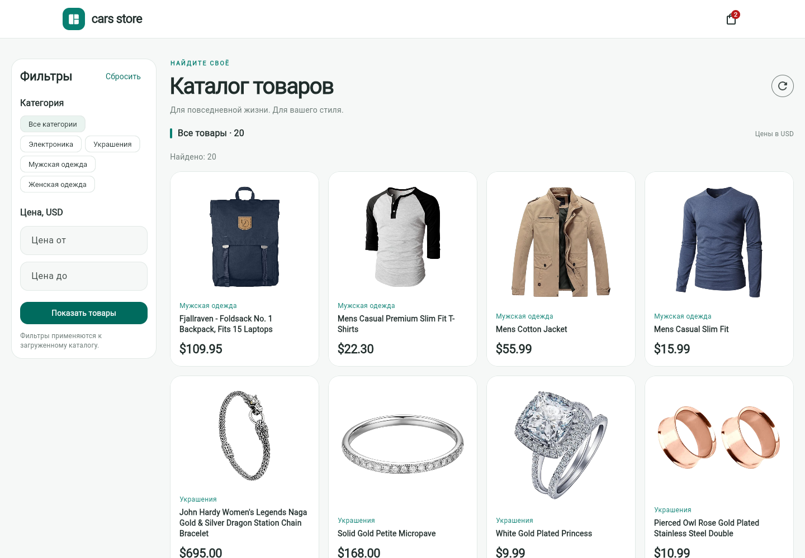
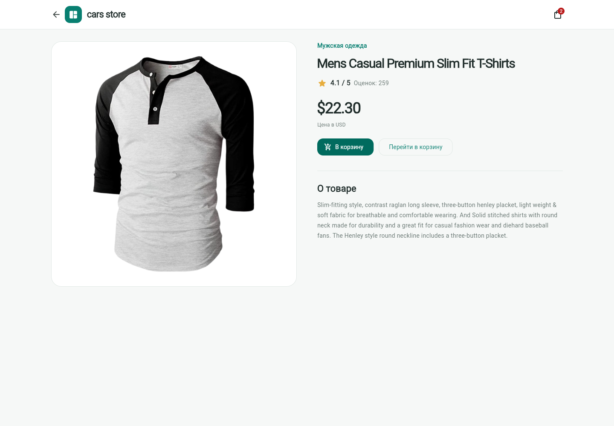
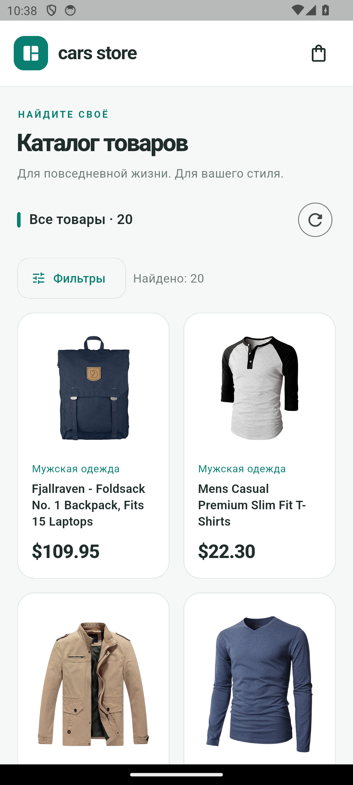
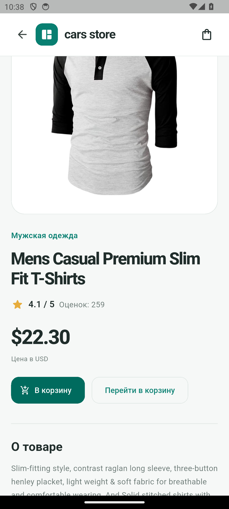
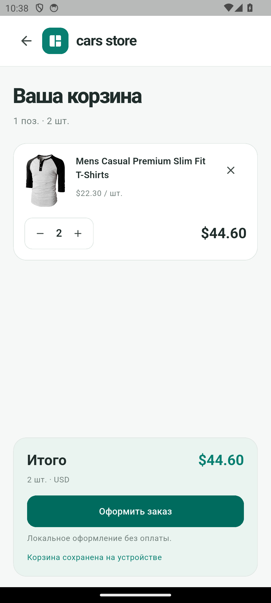

# cars_store

Тестовое приложение: каталог товаров FakeStore API с фильтрами, корзиной
и локальным оформлением заказа. Интерфейс адаптирован для Web и Android;
сохранённые товары и корзина доступны без подключения к сети.

## Скриншоты

### Web




### Android

<p>
  
  
  
</p>

## Возможности

- Каталог с загрузкой, повтором запроса и отдельными состояниями ошибки и пустого ответа.
- Локальные фильтры по категории и диапазону цены, сочетание и сброс фильтров.
- Карточка с описанием, рейтингом и количеством товара в корзине.
- Корзина с изменением количества, удалением, пересчётом суммы и сохранением между запусками.
- Форма заказа с проверкой контактов, локальным номером и очисткой корзины после оформления.
- Кэш каталога, индикация отсутствия сети и обновление после восстановления подключения.

## Запуск

Нужны FVM и Flutter **3.47.9** / Dart **3.13.7**. Версия SDK закреплена в `.fvmrc`,
зависимости — в `pubspec.lock`. Для Android нужны Android SDK, эмулятор или устройство и JDK 21.

```sh
fvm install
fvm flutter pub get
fvm flutter run -d chrome
fvm flutter devices
fvm flutter run -d <android-device-id>
fvm flutter test
```

Проверки и сборки:

```sh
fvm dart format lib test
fvm flutter analyze
fvm flutter build web
fvm flutter build apk --debug
```

Для просмотра Web-сборки с прямыми URL: `python3 tool/serve_web.py --port 8158`.
На хостинге требуется перенаправление неизвестных путей на `index.html`.
Debug APK находится в `build/app/outputs/flutter-apk/app-debug.apk`.

## Стек и архитектура

Cubit (`flutter_bloc`) управляет состояниями, `equatable` — их сравнением.
Dio отвечает за HTTP и таймауты, SharedPreferencesAsync — за небольшой локальный кэш
и корзину. `go_router` поддерживает переходы и прямые URL товаров,
`connectivity_plus` сообщает об изменении подключения, `cached_network_image`
показывает изображения с состояниями загрузки и ошибки. Интерфейс построен на Material 3.

Код разделён по feature: `catalog`, `cart`, `checkout`. В каталоге и корзине
разделены domain, data и presentation: виджеты обращаются к Cubit, а работа с API
и хранилищем находится в репозиториях. Зависимости собираются вручную.
Checkout использует локальную форму и существующий CartCubit без дополнительного слоя сервисов.
Суммы рассчитываются целыми центами; изменения корзины сохраняются последовательно.

В проекте 10 unit/widget-тестов: корзина, репозиторий каталога и состояния экрана.
`test/support/` содержит общие товары для проверок и реализацию корзины в памяти,
чтобы тесты не зависели от диска и платформенных плагинов. Для подмен используется `mocktail`.

## Offline-first

При запуске сначала читается сохранённый каталог, затем запрашиваются свежие данные.
Ошибка обновления оставляет товары на экране. Фильтры, карточки и корзина работают
локально. После восстановления подключения каталог обновляется автоматически;
наличие Wi-Fi само по себе не считается подтверждением доступности API.

Корзина хранит собственные снимки товаров и восстанавливается до первых изменений.
Если очистку при оформлении сохранить не удалось, товары остаются и можно повторить попытку.

## Ограничения

- Заказ учебный: без backend, оплаты, доставки и истории. Контакты не сохраняются.
- Для первого запуска нужны сеть и доступный FakeStore API.
- Уже открытое Web-приложение работает с сохранёнными данными без сети, но холодный запуск
  и жёсткая перезагрузка Web офлайн не гарантированы: offline app shell не реализован.
- Сохранение каталога не гарантирует наличие изображений офлайн. На Android используется
  файловый кэш изображений; на Web доступность зависит от браузерного кэша.
- Локальные данные могут быть удалены браузером или системой; это не серверное хранилище.
- Проверены Chrome и Android-эмулятор API 34. Остальные браузеры, физические устройства
  и подписанная release-сборка Android отдельно не проверялись.
